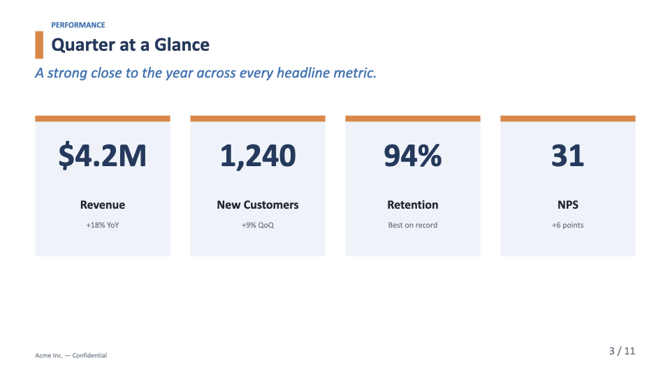
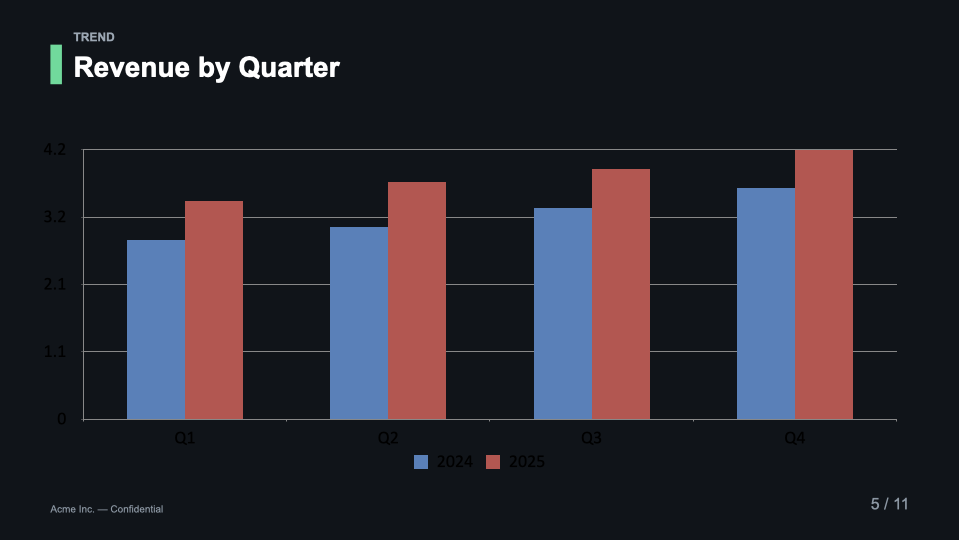
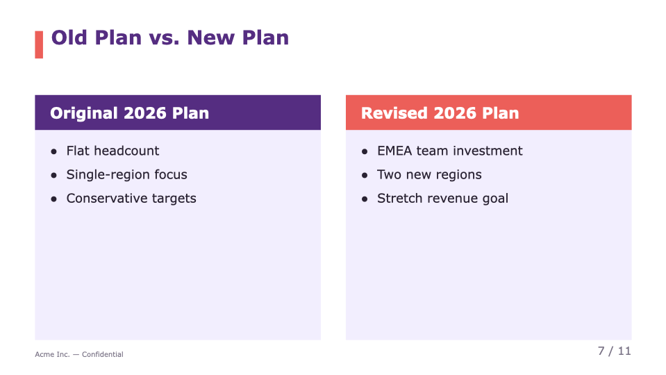
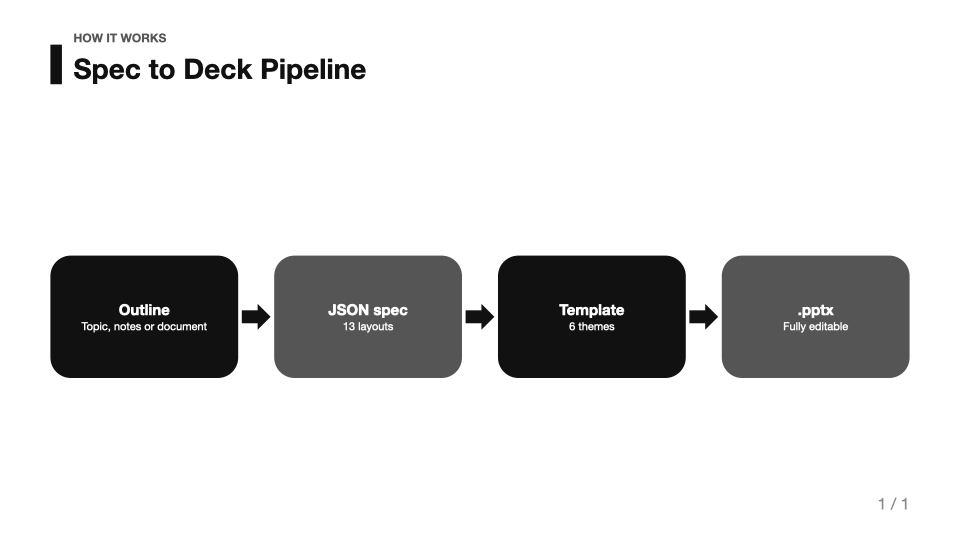

# ppt-generator

A [Claude Code](https://claude.com/claude-code) skill that turns a topic,
outline, notes, or document into a complete, **editable PowerPoint (`.pptx`)**
deck — rendered in a visual template of your choice.

It separates **what** goes on each slide (a JSON *presentation spec*) from
**how** it looks (a *template*), so the same content can be re-rendered in any
template by changing one field. Inspired by the content → layout → render
pipeline of [Presenton](https://github.com/presenton/presenton), but fully
local: no server, no API, native `.pptx` via [python-pptx](https://python-pptx.readthedocs.io/).

## Features

- **7 templates** — `samsung` (default), `corporate`, `minimal`, `dark`,
  `vibrant`, `academic`, `report`; every one passes WCAG contrast checks.
- **18 layouts** — title, section, agenda, bullets (incl. numbered), content,
  two_column, comparison, cards, metrics, big_number, quote, image, table,
  chart, **diagram**, matrix (2×2), icon_grid, closing.
- **Editable diagrams** — `process`, `cycle`, `hierarchy`, `pyramid`, `funnel`,
  `timeline`, `flowchart`, drawn as native PowerPoint shapes (not flattened
  images), so every box stays editable after generation.
- **165 editable icons** (Phosphor, MIT) drawn as recolorable shapes, with
  English/Korean concept aliases (`"보안"` → shield).
- **Text that fits** — measured before writing (calibrated to Malgun Gothic and
  PowerPoint's line rule): titles shrink or wrap, body text scales, overlong
  lists and tables continue on "(계속)/(cont.)" slides.
- **Korean typography** — East Asian font and `ko-KR` on every run, word (어절)
  line breaks, no faux-italic Hangul.
- **Themed native charts & tables** (palette, highlight, number formats) that
  remain editable in PowerPoint; real bullets and speaker notes.
- **Validator + visual QA** — structure, density, contrast and dry-run fit
  checks; LibreOffice or PowerPoint contact-sheet previews with an
  empty-space check.
- **Edit existing decks** (Mode B) — replace text, edit tables/charts, refit
  images, add template chrome, renumber pages; a COM path for DRM-protected
  decks on Windows.
- Restyle a whole deck by changing one `template` field.

## Requirements

```bash
python3 -m venv .venv && source .venv/bin/activate   # optional
pip install python-pptx Pillow pymupdf
# visual previews: LibreOffice (any OS) or desktop PowerPoint + pywin32 (Windows)
```

## Quick start

```bash
# 1. Write a presentation spec (see assets/spec.example.json)
# 2. Validate it
python3 scripts/validate_spec.py my-deck.spec.json
# 3. Render to .pptx
python3 scripts/build_pptx.py my-deck.spec.json -o my-deck.pptx
```

Minimal spec:

```json
{
  "template": "corporate",
  "title": "Launch Plan",
  "slides": [
    {"layout": "title", "title": "Launch Plan", "subtitle": "Q1 rollout"},
    {"layout": "bullets", "title": "Goals",
     "bullets": ["Ship to 3 regions", "99.9% uptime", "Onboard 50 teams"]},
    {"layout": "closing", "title": "Thank You"}
  ]
}
```

## Screens

All slides below were rendered from `assets/spec.example.json` (plus one
`diagram` slide) and exported from the generated `.pptx` without manual edits.

<table>
<tr>
<td></td>
<td></td>
</tr>
<tr>
<td><code>corporate</code> template, <code>metrics</code> layout</td>
<td><code>dark</code> template, <code>chart</code> layout (native, editable chart)</td>
</tr>
<tr>
<td></td>
<td></td>
</tr>
<tr>
<td><code>vibrant</code> template, <code>comparison</code> layout</td>
<td><code>minimal</code> template, <code>diagram</code> layout (<code>process</code>, native shapes)</td>
</tr>
</table>

## Repository layout

| Path | What |
|------|------|
| `SKILL.md` | The skill definition and workflow (entry point for Claude Code). |
| `scripts/build_pptx.py` | Renderer: spec JSON + template → `.pptx`. |
| `scripts/templates.py` | Template (theme) definitions. |
| `scripts/validate_spec.py` | Spec validator (deck + edit specs, dry-run fit check). |
| `scripts/textfit.py` | Text measurement used for fitting and linting. |
| `scripts/icons.py`, `assets/icons/` | Bundled icons (Phosphor, MIT) and their drawing code. |
| `scripts/render_preview.py` | LibreOffice contact-sheet preview + layout metrics. |
| `scripts/edit_pptx.py`, `extract_pptx.py`, `inspect_pptx.py` | Mode B: read and edit existing decks. |
| `scripts/*_com.py`, `thumbnail.py` | Windows PowerPoint (COM) tooling and previews. |
| `tests/` | Renderer/validator regression tests (`python3 -m unittest discover -s tests`). |
| `evals/` | Mode A/B scenario evals and graders. |
| `references/` | Spec schema, layout catalog, template catalog. |
| `assets/spec.example.json` | Full worked example exercising every layout. |
| `ppt-generator.skill` | Packaged skill, installable into Claude Code. |

## Install as a Claude Code skill

Copy this folder into your Claude Code skills directory:

```bash
cp -R ppt-generator ~/.claude/skills/ppt-generator
```

or install the packaged `ppt-generator.skill` file.

## Content style

Slide titles are noun phrases by default (`"title_style": "assertion"` switches
content slides to one-sentence takeaway headlines); body content is short
bulleted noun-phrase fragments rather than prose, with the explanation in
speaker notes. See `SKILL.md` for the full design
guidance.

## License

MIT
